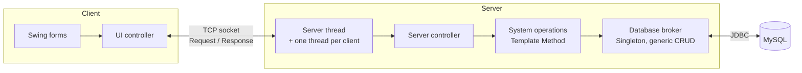
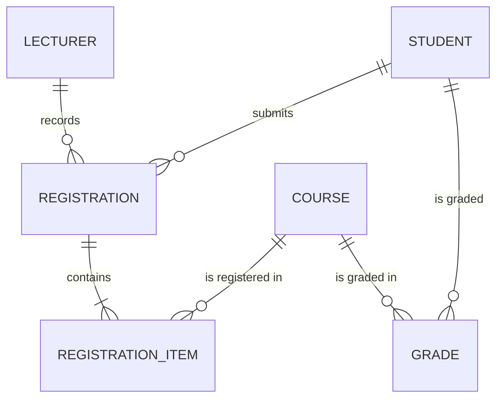

# Course Registration System: Java Client–Server Application

A multi-user desktop application in which lecturers manage students and their course registrations, and the system calculates how much each student owes. The design was done use-case-first with UML. The implementation is a three-tier Java client–server system over TCP sockets, with a multithreaded server, a generic JDBC data layer and transactional business operations.

> Developed as my bachelor's project at the University of Belgrade, Faculty of Organizational Sciences (2024).

## What it does

A lecturer logs in and can:

- **create, search, update and delete students**;
- **create, search, update and delete course registrations**. A registration belongs to a student and contains one or more courses; each course item carries ECTS credits and a price per credit, and the total price is calculated automatically;
- see **students' grades per course**.

Several lecturers can work at the same time, and search screens refresh automatically to show other users' changes.

## Highlights

- **Use-case-driven design**: 9 use cases (2 of them master–detail), 15 system operations with contracts, a domain model and a relational model with full integrity rules.
- **Client–server over sockets**: serialised request/response objects over TCP, and a **thread per connected client** on the server.
- **Transactional business logic**: every system operation follows the **Template Method** pattern (`validate → execute → commit`, `rollback` on any error), so a registration and all its items are saved or none are.
- **Generic data access layer**: one Singleton database broker performs CRUD for every entity. Each domain class describes its own table, so adding an entity needs no new SQL in the broker.
- **Swing client** with custom table models, a two-part UI controller (generic + form-specific) and background refresh threads.
- **JUnit tests** for the login system operation.

## Architecture



How one request travels through the system, from a button click to the database and back, is described in [docs/architecture.md](docs/architecture.md#request-lifecycle).

## Data model



A registration is a **master–detail aggregate**: it cannot exist without items, and deleting it deletes its items. Lecturers, students and courses that are still referenced cannot be deleted. Full schema and constraints: [docs/data-model.md](docs/data-model.md).

## Tech stack

| Area | Technology |
|---|---|
| Language | Java 21 |
| UI | Swing, FlatLaf |
| Networking | Java sockets, object serialisation, threads |
| Data access | JDBC, MySQL 8.4 |
| Testing | JUnit 4 |
| Design | UML: use cases, sequence diagrams, contracts, conceptual and relational models |
| Tools | Apache NetBeans IDE 21 |

## Documentation

| Document | Contents |
|---|---|
| [Use cases](docs/use-cases.md) | All 9 use cases with main and alternative flows, and sequence diagrams for the two complex ones |
| [System operations](docs/system-operations.md) | The 15 system operations, their contracts and how the server executes them |
| [Data model](docs/data-model.md) | Domain model, relational schema, integrity constraints and the pricing rule |
| [Architecture](docs/architecture.md) | Modules, request lifecycle, client, communication, server, code examples, design patterns, testing and what I would improve today |

## Project structure

```
Client   – Swing forms, table models, UI controller, session (socket + logged-in user)
Server   – server window, server/client threads, controller, system operations, database broker
Common   – domain classes and request/response transfer objects shared by client and server
```
