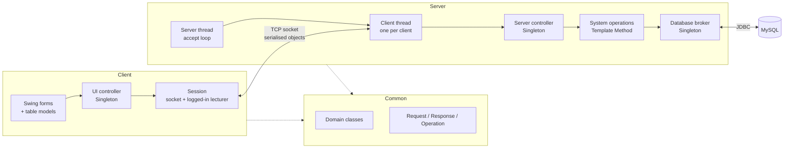
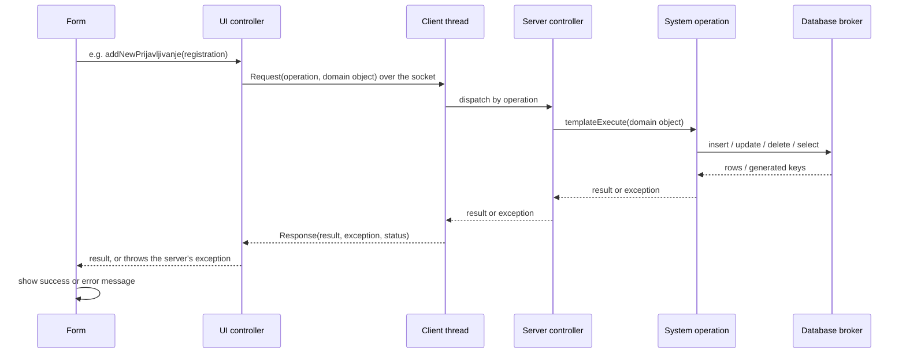

# Architecture

## Overview

The system is a **three-tier client–server desktop application**:

| Tier | Runs on | Responsibility |
|---|---|---|
| User interface | Client | Swing screen forms and the UI controller |
| Application logic | Server | Request handling, system operations, transactions |
| Data storage | Server | MySQL database, accessed through a database broker |

The code is split into three modules:

| Module | Contents |
|---|---|
| **Client** | Swing forms, table models, the UI controller and the session that holds the socket and the logged-in lecturer |
| **Server** | Server window (start/stop, database settings), server and client threads, server controller, system operations, database broker |
| **Common** | Domain classes and the transfer objects (request, response, operation codes), used by both client and server |



## Request lifecycle



## Client

**Screen forms.** Each use case is carried out through Swing forms built in the NetBeans GUI designer and styled with FlatLaf. Tables use custom `AbstractTableModel` classes. The two search forms start a background thread that refreshes the table every 10 seconds, so changes made by other lecturers appear without reopening the form.

**UI controller.** The controller has two parts:

- a **general part**, independent of any form, which connects the UI to the server, sends a request for a system operation, receives the response and either returns the result or throws the exception that occurred on the server;
- a **concrete part**, tied to each form, which converts what the user entered into domain objects and converts domain objects back into what the form displays.

The general part is one method that every operation goes through:

```java
private Object sendRequest(Object parametar, Operacije operacija) throws Exception {
    KlijentskiZahtev zahtev = new KlijentskiZahtev(parametar, operacija);
    new ObjectOutputStream(Session.getInstance().getSocket().getOutputStream()).writeObject(zahtev);

    ServerskiOdgovor odgovor = (ServerskiOdgovor)
            new ObjectInputStream(Session.getInstance().getSocket().getInputStream()).readObject();

    if (odgovor.getStatusOdgovora().equals(StatusOdgovora.Neuspesno)) {
        throw odgovor.getException();      // server-side error re-thrown on the client
    }
    return odgovor.getRezultat();
}

public void addNewPrijavljivanje(Prijavljivanje p) throws Exception {
    sendRequest(p, Operacije.ADD_NEW_PRIJAVLJIVANJE);
}
```

## Communication

- Client and server exchange **serialised Java objects** over one TCP socket per client.
- A **request** carries the operation code and the domain object to work on.
- A **response** carries the result, the exception (if any) and a success/failure status. This lets the client decide whether the postconditions of the operation were met.
- The operation codes are shared by both sides in the common module.

## Server

**Threads.** The server thread holds the `ServerSocket` and loops on `accept()`. Every accepted connection gets its own **client thread**, so several lecturers can work at the same time. The client thread reads requests, dispatches them by operation code to the server controller and writes back the response.

```java
public void run() {
    while (!serversocket.isClosed()) {
        Socket socket = serversocket.accept();     // wait for a client
        new ThreadClient(socket).start();          // one thread per client
    }
}
```

**Server controller.** A Singleton facade with one method per system operation. It creates the operation object, runs it and returns its result. It also keeps the list of logged-in lecturers.

### System operations (Template Method)

Every system operation extends `AbstractSO`. The base class fixes the algorithm, and each subclass supplies only validation and execution. Every operation is one transaction.

```java
public abstract class AbstractSO {

    protected abstract void validate(AbstractDomainObject ado) throws Exception;
    protected abstract void execute(AbstractDomainObject ado) throws Exception;

    public void templateExecute(AbstractDomainObject ado) throws Exception {
        try {
            validate(ado);
            execute(ado);
            commit();
        } catch (Exception e) {
            rollback();
            throw e;
        }
    }
}
```

Example: creating a registration saves the master row, reads its generated key and saves every item, all in one transaction. If any insert fails, nothing is saved.

```java
public class SOAddNewPrijavljivanje extends AbstractSO {

    @Override
    protected void validate(AbstractDomainObject ado) throws Exception {
        if (!(ado instanceof Prijavljivanje)) {
            throw new Exception("Prosledjeni objekat nije instanca klase Prijavljivanje!");
        }
        if (((Prijavljivanje) ado).getKurs().isEmpty()) {
            throw new Exception("Prijavljivanje mora imati barem jedan kurs!"); // must have at least one item
        }
    }

    @Override
    protected void execute(AbstractDomainObject ado) throws Exception {
        PreparedStatement ps = DBBroker.getInstance().insert(ado);   // master row
        ResultSet keys = ps.getGeneratedKeys();
        keys.next();
        Prijavljivanje pr = (Prijavljivanje) ado;
        pr.setPrijavljivanjeID(keys.getInt(1));

        for (Kurs item : pr.getKurs()) {      // detail rows: the registration items
            item.setPrijavljivanje(pr);
            DBBroker.getInstance().insert(item);
        }
    }
}
```

### Generic database broker

The database broker is a **Singleton** that reads the connection settings (URL, user, password) from a configuration file, opens one JDBC connection and turns auto-commit off, so transactions are controlled by the system operations.

The broker contains **no table-specific SQL**. Every domain class extends `AbstractDomainObject` and describes its own table: name, alias, joins, insert columns and values, update values, primary-key condition, and how to map a `ResultSet` row to objects. One broker therefore handles select, insert, update and delete for every entity.

```java
public abstract class AbstractDomainObject implements Serializable {
    public abstract String nazivTabele();                 // table name
    public abstract String alijas();                      // table alias
    public abstract String join();                        // JOIN clause for related tables
    public abstract ArrayList<AbstractDomainObject> vratiListu(ResultSet rs) throws SQLException;
    public abstract String koloneZaInsert();
    public abstract String vrednostiZaInsert();
    public abstract String vrednostiZaUpdate();
    public abstract String vrednostZaPrimarniKljuc();     // WHERE condition for the primary key
    public abstract String uslov();                       // optional WHERE condition
}
```

```java
public ArrayList<AbstractDomainObject> select(AbstractDomainObject ado) throws SQLException {
    String query = "SELECT * FROM " + ado.nazivTabele() + " " + ado.alijas()
                 + " " + ado.join() + " " + ado.uslov();
    ResultSet rs = connection.createStatement().executeQuery(query);
    return ado.vratiListu(rs);
}
```

Adding a new entity means writing one domain class. The broker does not change.

## Design patterns used

| Pattern | Where | Why |
|---|---|---|
| Template Method | `AbstractSO` | Same validate → execute → commit/rollback flow for every operation |
| Singleton | Database broker, server controller, UI controller, session | One shared connection, controller and socket per process |
| Thread per client | Server and client threads | Several lecturers can work at the same time |
| Data transfer objects | Request and response classes | One uniform message format between client and server |
| Generic DAO | `AbstractDomainObject` + database broker | CRUD for all entities without entity-specific SQL |
| Table model (MVC) | Custom `AbstractTableModel` classes | Separates table data from the Swing view |

## Testing

The login system operation has a **JUnit 4** test class with a valid and an invalid lecturer. The test fixture inserts a lecturer through the database broker before each test.

```java
@Before
public void setUp() throws SQLException {
    predavac = new Predavac();
    predavac.setUsername("ivana123");
    predavac.setPassword("ivana123");
    DBBroker.getInstance().insert(predavac);
}

// wrong credentials: login must fail
@Test(expected = Exception.class)
public void testLoginPogresniKredencijali() throws Exception {
    Predavac pogresan = new Predavac();
    pogresan.setUsername("pogresno");
    pogresan.setPassword("pogresno");
    new SOLogin().templateExecute(pogresan);
}

// correct credentials: the lecturer is logged in
@Test
public void testLoginTacniKredencijali() throws Exception {
    SOLogin so = new SOLogin();
    so.templateExecute(predavac);
    assertNotNull(so.getUlogovani());
    assertEquals(predavac.getUsername(), so.getUlogovani().getUsername());
}
```

Every use case scenario was also tested manually through the UI with valid and invalid data, including the alternative flows.

## What I would improve today

Looking back at this project with more experience, I would:

- use `PreparedStatement` parameters everywhere instead of building SQL strings, to prevent SQL injection;
- store password hashes instead of plain-text passwords;
- replace the single shared JDBC connection with a connection pool, so client threads do not share one transaction context;
- move the build from NetBeans Ant to Maven or Gradle, so dependencies are declared instead of being local JAR paths;
- add tests for the registration operations (create, update, delete) and run them against a test database.
