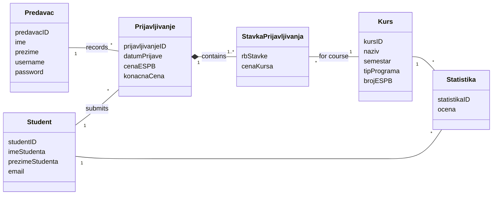
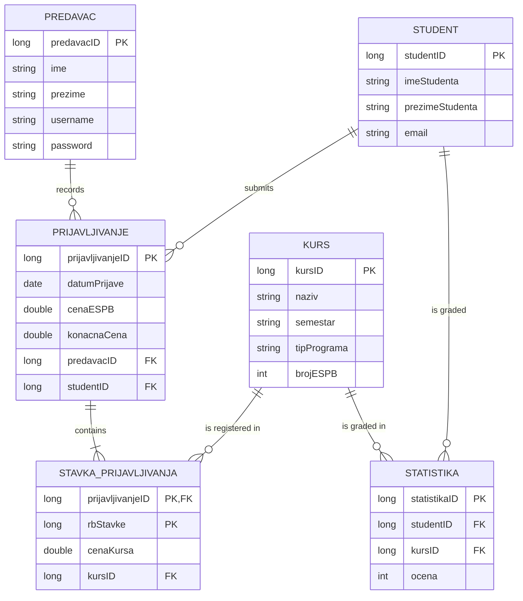

# Data Model

## Domain model

Six domain classes describe the problem. The class names in the code are Serbian; the English meaning is given in the table.

| Class | Meaning | Attributes |
|---|---|---|
| `Predavac` | Lecturer, the system user | id, first name, last name, username, password |
| `Student` | Student | id, first name, last name, e-mail |
| `Kurs` | Course | id, name, semester, programme type, ECTS credits |
| `Prijavljivanje` | Registration (master) | id, date, price per ECTS credit, total price, lecturer, student |
| `StavkaPrijavljivanja` | Registration item (detail) | item number, course, course price |
| `Statistika` | A student's grade in a course | id, student, course, grade |



**Registration is a master–detail aggregate.** A registration cannot exist without at least one item, the items are always saved, changed and deleted together with their registration, and the total price is derived from the items. This is why creating and updating a registration are the two complex use cases.

**Business rule: total price.** The price of each item is the course's ECTS credits multiplied by the price per ECTS credit, and the registration's total price is the sum of its items. The client recalculates the total whenever an item is added or removed.

## Relational model

```
Predavac(predavacID, ime, prezime, username, password)
Student(studentID, imeStudenta, prezimeStudenta, email)
Kurs(kursID, naziv, semestar, tipPrograma, brojESPB)
Prijavljivanje(prijavljivanjeID, datumPrijave, cenaESPB, konacnaCena, predavacID, studentID)
StavkaPrijavljivanja(prijavljivanjeID, rbStavke, cenaKursa, kursID)
Statistika(statistikaID, studentID, kursID, ocena)
```



The registration item has a **composite primary key** (registration id + item number): an item is identified within its registration, not globally.

## Integrity constraints

**Value constraints:** all ids are mandatory and greater than 0; names, username, password, e-mail, semester and programme type are mandatory; an item's course price must be greater than 0; date, price per credit and total price of a registration are mandatory.

**Referential (structural) constraints:**

| Table | Insert | Update | Delete |
|---|---|---|---|
| Predavac | – | cascades to Prijavljivanje | restricted by Prijavljivanje |
| Student | – | cascades to Prijavljivanje, Statistika | restricted by Prijavljivanje, Statistika |
| Kurs | – | cascades to StavkaPrijavljivanja, Statistika | restricted by StavkaPrijavljivanja, Statistika |
| Prijavljivanje | requires existing Predavac and Student | restricted by Predavac, Student; cascades to StavkaPrijavljivanja | **cascades to StavkaPrijavljivanja** |
| StavkaPrijavljivanja | requires existing Prijavljivanje and Kurs | restricted by Prijavljivanje, Kurs | – |
| Statistika | requires existing Student and Kurs | restricted by Student, Kurs | – |

In practice: a lecturer, student or course that is still referenced cannot be deleted, while deleting a registration automatically deletes its items.
