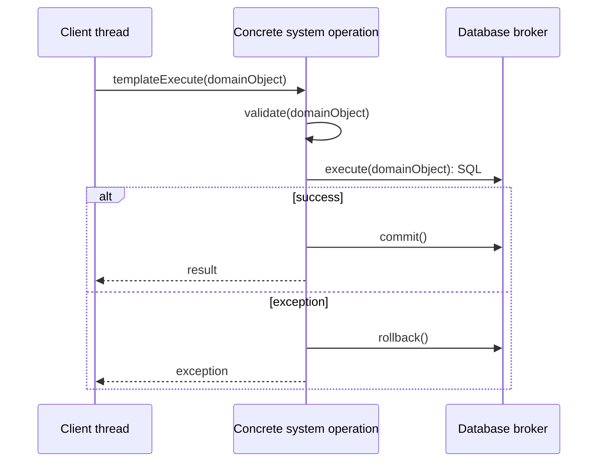

# System Operations and Contracts

Analysing the use case scenarios produced **15 system operations**. Each one is a single request from the client to the server, and each has a contract that states *what* the operation guarantees, not how it is implemented.

The original identifiers in the code are Serbian; they are listed next to the English names.

| # | Operation | Original identifier | Input → output | Used in |
|---|---|---|---|---|
| 1 | `login` | `login(Predavac)` | lecturer credentials → logged-in lecturer | UC1 |
| 2 | `createStudent` | `kreirajStudenta(Student)` | student → – | UC2 |
| 3 | `loadStudentList` | `ucitajListuStudenata(List<Student>)` | – → all students | UC3–UC6 |
| 4 | `findStudents` | `nadjiStudente(value, List<Student>)` | search value → matching students | UC3–UC5 |
| 5 | `loadStudent` | `ucitajStudenta(Student)` | student → student data | UC3–UC5 |
| 6 | `updateStudent` | `izmeniStudenta(Student)` | student → – | UC4 |
| 7 | `deleteStudent` | `obrisiStudenta(Student)` | student → – | UC5 |
| 8 | `loadRegistrationList` | `ucitajListuPrijavljivanja(List<Prijavljivanje>)` | – → all registrations | UC7–UC9 |
| 9 | `createRegistration` | `kreirajPrijavljivanje(Prijavljivanje)` | registration + items → – | UC6 |
| 10 | `loadCourseList` | `ucitajListuKurseva(List<Kurs>)` | – → all courses | UC6, UC7 |
| 11 | `findRegistrations` | `nadjiPrijavljivanja(value, List<Prijavljivanje>)` | search value → matching registrations | UC7–UC9 |
| 12 | `loadRegistration` | `ucitajPrijavljivanje(Prijavljivanje)` | registration → registration + items | UC7–UC9 |
| 13 | `updateRegistration` | `izmeniPrijavljivanje(Prijavljivanje)` | registration + items → – | UC7 |
| 14 | `deleteRegistration` | `obrisiPrijavljivanje(Prijavljivanje)` | registration → – | UC9 |
| 15 | `loadGradeList` | `ucitajListuStatistika(List<Statistika>)` | – → all grades | UC6 |

Every operation returns a **signal** to the client: success with an optional result, or failure with the exception that occurred.

## Contracts

Operations that only read data have no preconditions or postconditions. The contracts below are for operations that change the system state.

### createStudent
- **Use case:** UC2
- **Precondition:** The structural and value constraints on *Student* are satisfied.
- **Postcondition:** A new student exists.

### updateStudent
- **Use case:** UC4
- **Precondition:** The structural and value constraints on *Student* are satisfied.
- **Postcondition:** The student's data is changed.

### deleteStudent
- **Use case:** UC5
- **Precondition:** The structural and value constraints on *Student* are satisfied (the student has no registrations or grades that restrict deletion).
- **Postcondition:** The student no longer exists.

### createRegistration
- **Use case:** UC6
- **Precondition:** The structural and value constraints on *Registration* and its items are satisfied.
- **Postcondition:** The registration and all its items are saved.

### updateRegistration
- **Use case:** UC7
- **Precondition:** The structural constraints on *Registration* are satisfied.
- **Postcondition:** The registration and its items reflect the new data.

### deleteRegistration
- **Use case:** UC9
- **Precondition:** The structural constraints on *Registration* are satisfied.
- **Postcondition:** The registration and all its items no longer exist.

### login
- **Use case:** UC1
- **Precondition / postcondition:** none. The operation either returns the matching lecturer or fails.

## How an operation is executed on the server

Every operation is a class that extends one abstract base class and follows the same template: **validate → execute → commit**, with a **rollback** if anything fails. Each operation runs as one database transaction. See [architecture.md](architecture.md#system-operations-template-method) for details.

