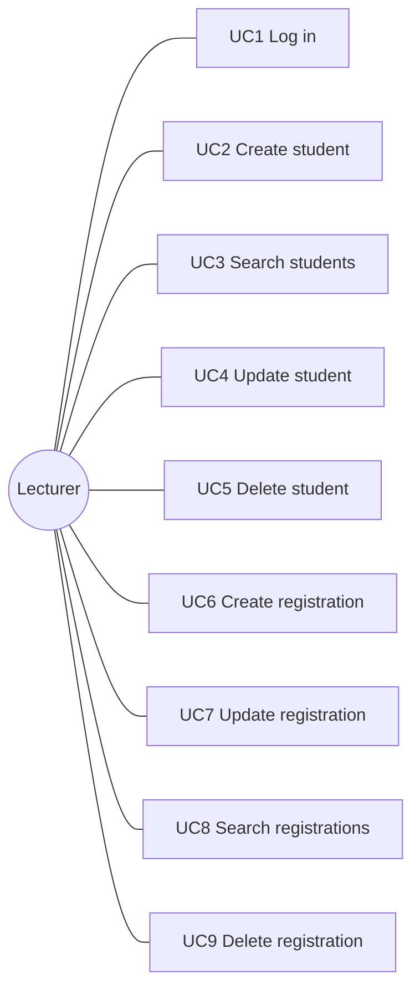
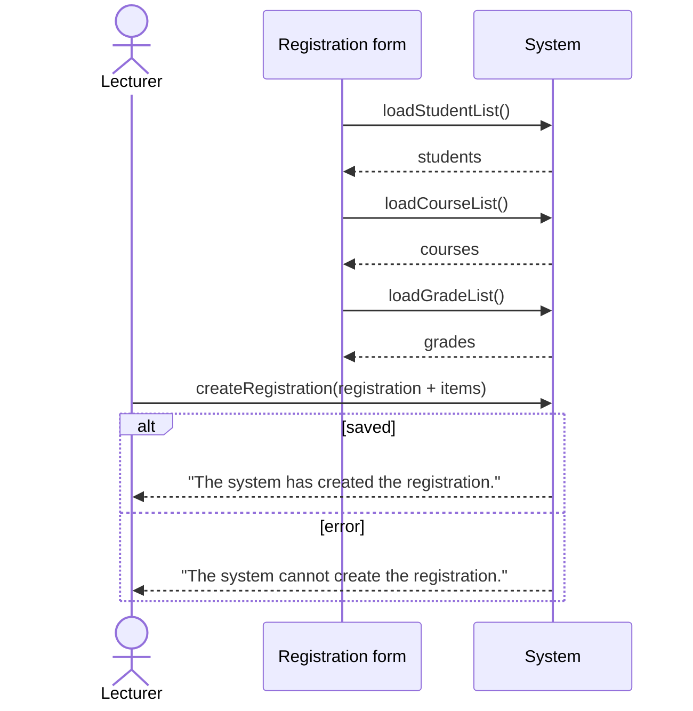
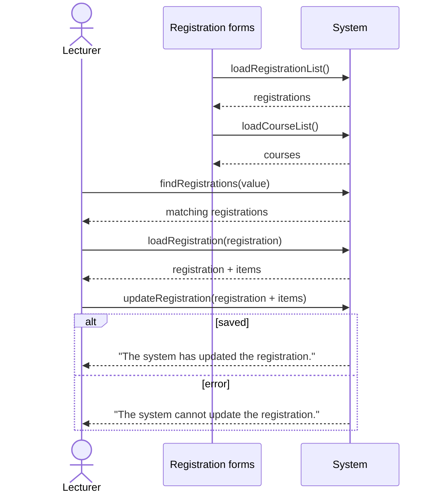

# Use Cases

The system has one actor, the **Lecturer**, who logs in and manages students and their course registrations. Nine use cases were identified. Two of them, creating and updating a registration, are **complex use cases** because a registration is a master–detail object (a registration with one or more course items).

| # | Use case | System operations used |
|---|---|---|
| UC1 | Log in | `login` |
| UC2 | Create student | `createStudent` |
| UC3 | Search students | `loadStudentList`, `findStudents`, `loadStudent` |
| UC4 | Update student | `loadStudentList`, `findStudents`, `loadStudent`, `updateStudent` |
| UC5 | Delete student | `loadStudentList`, `findStudents`, `loadStudent`, `deleteStudent` |
| UC6 | Create registration *(complex)* | `loadStudentList`, `loadCourseList`, `loadGradeList`, `createRegistration` |
| UC7 | Update registration *(complex)* | `loadRegistrationList`, `loadCourseList`, `findRegistrations`, `loadRegistration`, `updateRegistration` |
| UC8 | Search registrations | `loadRegistrationList`, `findRegistrations`, `loadRegistration` |
| UC9 | Delete registration | `loadRegistrationList`, `findRegistrations`, `loadRegistration`, `deleteRegistration` |

The operations are specified in [system-operations.md](system-operations.md). The application's user interface is in Serbian; button labels and messages below are translated.

---

## UC1: Log in

**Precondition:** The application is running and shows the login form.

**Main flow**
1. The lecturer enters a username and password.
2. The lecturer clicks **Log in**; the client calls `login`.
3. The system looks up the lecturer.
4. The system opens the main window and shows *"You have successfully logged in."*

**Alternative flows**
- 3a. No lecturer matches the credentials: the system shows *"Login failed, please try again."*

---

## UC2: Create student

**Precondition:** The lecturer is logged in. The student form is open.

**Main flow**
1. The lecturer enters the student's first name, last name and e-mail.
2. The lecturer checks the input and clicks **Add student**; the client calls `createStudent`.
3. The system validates and saves the student.
4. The system shows *"The system has created the student."*

**Alternative flows**
- 3a. The student cannot be saved: the system shows *"The system cannot create the student."*

---

## UC3: Search students

**Precondition:** The lecturer is logged in. The student search form is open and has loaded the list of students (`loadStudentList`).

**Main flow**
1. The lecturer types a search value. Each key press triggers `findStudents`.
2. The system shows the matching students in a table.
3. The lecturer selects a student and opens the details; the client calls `loadStudent`.
4. The system shows the student's data and *"The system has loaded the student."*

**Alternative flows**
- 2a. No student matches: the system shows *"The system cannot find students by the given value."* The use case ends.
- 4a. The student cannot be loaded: the system shows *"The system cannot load the student."*

---

## UC4: Update student

**Precondition:** The lecturer is logged in. The student search form is open and has loaded the list of students.

**Main flow**
1. The lecturer searches for and selects a student, as in UC3.
2. The lecturer clicks **Student details**; the client calls `loadStudent`, and the details form opens.
3. The lecturer changes the data, checks it and clicks **Update**; the client calls `updateStudent`.
4. The system validates and saves the changes.
5. The system shows *"The system has updated the student's data."*

**Alternative flows**
- 1a. No student matches: *"The system cannot find students by the given value."* The use case ends.
- 2a. The student cannot be loaded: *"The system cannot load the student."* The use case ends.
- 4a. The changes cannot be saved: *"The system cannot update the student."*

---

## UC5: Delete student

**Precondition:** The lecturer is logged in. The student search form is open and has loaded the list of students.

**Main flow**
1. The lecturer searches for and selects a student, as in UC3.
2. The lecturer clicks **Student details**; the client calls `loadStudent`.
3. The lecturer clicks **Delete**; the client calls `deleteStudent`.
4. The system deletes the student.
5. The system shows *"The system has deleted the student."*

**Alternative flows**
- 1a. No student matches: *"The system cannot find students by the given value."* The use case ends.
- 2a. The student cannot be loaded: *"The system cannot load the student."* The use case ends.
- 4a. The student cannot be deleted, for example because they have registrations: *"The system cannot delete the student."*

---

## UC6: Create registration *(complex)*

**Precondition:** The lecturer is logged in. The registration form is open and has loaded the lists of students, courses and grades.

**Main flow**
1. The lecturer selects the student and enters the registration date.
2. For each course, the lecturer selects the course, enters the ECTS credits and the price per credit, and adds it as an item. The form updates the total price after each change.
3. The lecturer checks the input and clicks **Add registration**; the client calls `createRegistration` with the registration and all its items.
4. The system saves the registration and its items in one transaction.
5. The system shows *"The system has created the registration."*

**Alternative flows**
- 4a. The registration cannot be saved, for example because it has no items: the transaction is rolled back and the system shows *"The system cannot create the registration."*

---

## UC7: Update registration *(complex)*

**Precondition:** The lecturer is logged in. The registration search form is open and has loaded the lists of registrations and courses.

**Main flow**
1. The lecturer types a student's name. Each key press triggers `findRegistrations`.
2. The system shows the matching registrations.
3. The lecturer selects a registration and clicks **Details**; the client calls `loadRegistration`.
4. The system shows the registration with its items and *"The system has loaded the registration."*
5. The lecturer changes the date and adds or removes course items. The total price is recalculated.
6. The lecturer clicks **Update**; the client calls `updateRegistration`.
7. The system saves the registration and replaces its items in one transaction.
8. The system shows *"The system has updated the registration."*

**Alternative flows**
- 2a. No registration matches: *"The system cannot find registrations by the given value."* The use case ends.
- 4a. The registration cannot be loaded: *"The system cannot load the registration."* The use case ends.
- 7a. The changes cannot be saved: the transaction is rolled back and the system shows *"The system cannot update the registration."*

---

## UC8: Search registrations

**Precondition:** The lecturer is logged in. The registration search form is open and has loaded the list of registrations.

**Main flow**
1. The lecturer types a student's name. Each key press triggers `findRegistrations`.
2. The system shows the matching registrations.
3. The lecturer selects a registration and clicks **Details**; the client calls `loadRegistration`.
4. The system shows the registration and *"The system has loaded the registration."*

**Alternative flows**
- 2a. No registration matches: *"The system cannot find registrations by the given value."* The use case ends.
- 4a. The registration cannot be loaded: *"The system cannot load the registration."*

---

## UC9: Delete registration

**Precondition:** The lecturer is logged in. The registration search form is open and has loaded the list of registrations.

**Main flow**
1. The lecturer searches for and opens a registration, as in UC8.
2. The lecturer clicks **Cancel registration** and confirms; the client calls `deleteRegistration`.
3. The system deletes the registration together with its items.
4. The system shows *"The system has deleted the registration."*

**Alternative flows**
- 1a. No registration matches or it cannot be loaded: the corresponding message is shown and the use case ends.
- 3a. The registration cannot be deleted: *"The system cannot delete the registration."*
